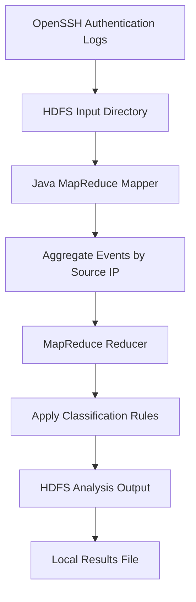
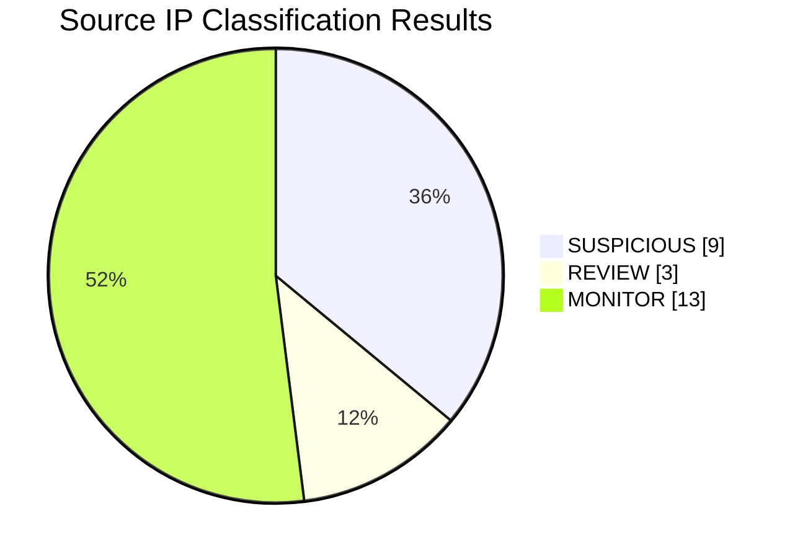

# Cloud-Based Cybersecurity Log Analytics

## Overview
A cloud-based cybersecurity log analysis project that processes OpenSSH authentication logs using Apache Hadoop MapReduce on an AWS EC2 Ubuntu instance. It aggregates authentication events by source IP address and classifies activity for further investigation.

## Objectives
- Analyze OpenSSH authentication logs.
- Aggregate failed-password attempts, invalid-user events, successful logins, and break-in warnings by IP address.
- Identify potentially suspicious authentication patterns using configurable rules.
- Store input logs and analysis output in Hadoop Distributed File System (HDFS).

## Technology Stack
- **Cloud:** AWS EC2
- **Operating System:** Ubuntu Server
- **Big Data Processing:** Apache Hadoop 3.4.2, MapReduce, YARN
- **Programming Language:** Java
- **Storage:** HDFS
- **Dataset:** OpenSSH logs from the LogHub project

## Architecture
OpenSSH Log Dataset → HDFS Input → Java MapReduce Mapper → Reducer → IP-Based Classification → HDFS Results

## Detection Rules
- **SUSPICIOUS:** Five or more failed-password events.
- **REVIEW:** At least one break-in warning or three or more invalid-user events, provided the suspicious threshold is not met.
- **MONITOR:** Events that do not meet either threshold.

These are heuristic classifications for investigation, not proof of malicious activity.

## Execution
```bash
# Check Hadoop
hadoop version

# List input files
hdfs dfs -ls /cybersecurity/input

# Run the analysis (output path must not already exist)
hadoop jar security-log-analyzer.jar SecurityLogAnalyzer \
  /cybersecurity/input/OpenSSH.log \
  /cybersecurity/output-analysis

# View the results
hdfs dfs -cat /cybersecurity/output-analysis/part-r-00000

# Copy results locally
hdfs dfs -get /cybersecurity/output-analysis/part-r-00000 \
  ~/cybersecurity-log-analytics/analysis-results.txt
```

## Verified Execution
- Input records processed: 2,000
- Mapper output records: 719
- Reducer output records: 25
- Map and reduce stages completed successfully.

These figures describe the current test run and should be updated if the dataset or implementation changes.

## Limitations and Future Improvements
- Expand IPv4 validation and test additional OpenSSH log formats.
- Add timestamps and time-window-based detection.
- Visualize findings in a dashboard.
- Evaluate detection rules against labeled test data.

## Responsible Use
This project analyzes a sample dataset for educational purposes. A classification alone does not establish that a source IP is malicious.

## Analysis Results

The MapReduce job successfully processed 2,000 OpenSSH log records and generated aggregated results for 25 source IP groups.

| Metric | Result |
|---|---:|
| Input log records | 2,000 |
| Mapper output records | 719 |
| Unique IP groups in output | 25 |
| SUSPICIOUS classifications | 9 |
| REVIEW classifications | 3 |
| MONITOR classifications | 13 |

### Processing Architecture



### Interpretation

- **SUSPICIOUS:** Repeated failed-password attempts met the configured threshold.
- **REVIEW:** Break-in warnings or repeated invalid-user events met the configured review rules.
- **MONITOR:** The activity did not meet either threshold.

These classifications are rule-based indicators for further investigation. They do not establish that an IP address is malicious.

### Dataset Attribution

The project uses OpenSSH authentication logs from the [LogHub dataset collection](https://github.com/logpai/loghub). Refer to the original repository for dataset details and usage terms.

## Classification Distribution

The chart below summarizes the rule-based classifications from the sample run.



These classifications identify activity for further investigation; they do not confirm malicious behavior.

## Automated Testing

The project includes lightweight Java tests for both security event classification and log parsing.

### Parser Test Scenarios

| Test scenario | Expected behavior |
|---|---|
| Failed password with source IP | Extract IP and event count |
| Invalid user with source IP | Extract IP and event count |
| Successful public-key login | Extract IP and event count |
| Break-in warning without an IP | Ignore the line |
| Unrelated log line | Ignore the line |
| Security event without an IP | Ignore the line |

### Classification Test Scenarios

| Test scenario | Expected result |
|---|---|
| 4 failed passwords | MONITOR |
| 5 failed passwords | SUSPICIOUS |
| 3 invalid-user events | REVIEW |
| 1 break-in warning | REVIEW |
| No suspicious events | MONITOR |
| 5 failures with other warning indicators | SUSPICIOUS |

### Run the Tests

From the project root directory, compile the project:

```bash
mkdir -p build tests
javac -classpath "$(hadoop classpath)" -d build \
  src/SecurityClassifier.java \
  src/SecurityLogParser.java \
  src/SecurityLogAnalyzer.java
```

Compile both test classes:

```bash
javac -cp build -d tests \
  tests/ClassificationTest.java tests/ParserTest.java
```

Run the classification tests:

```bash
java -cp build:tests ClassificationTest
```

Run the parser tests:

```bash
java -cp build:tests ParserTest
```

The current test suites contain six classification tests and 21 parser checks. Both should pass.

### Build the Hadoop JAR

```bash
jar -cf security-log-analyzer.jar -C build .
```

The JAR includes the analyzer, parser, and classifier classes.

These tests validate the rule-based classification logic. They do not establish that an IP address is definitively malicious.


## Final Hadoop Analysis Results

The updated parser and classifier were tested against the OpenSSH log dataset
using Hadoop MapReduce on AWS EC2.

| Metric | Result |
|---|---:|
| Input log records | 2,000 |
| Mapper output records | 719 |
| Reducer output records | 25 |
| Suspicious IP groups | 10 |
| Review IP groups | 3 |
| Monitor IP groups | 12 |

The 25 output rows represent source-IP groups. Classification is rule-based
and should be treated as an indicator for further investigation, not proof
of malicious activity.

The final output is available in `analysis-results-final.txt`.
